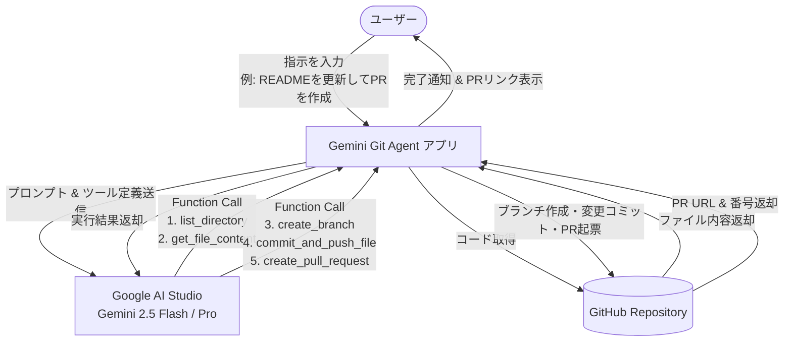

# Gemini Git Agent (Android)

Android 端末から自然言語で指示を出すだけで、**Google AI (Gemini API)** と **GitHub REST API** を連携させ、リポジトリのコード確認・修正・コミット・ブランチ作成・プルリクエスト起票までを完全自律型（Agentic Workflow）で実行する Android アプリケーションです。

---

## 🔒 セキュリティと認証情報に関する基本原則

本プロジェクトでは **クレデンシャルのリポジトリ混入を決して行いません**。

- **リポジトリ内の安全性の担保**:
  - API キー、アクセストークン、キーストア、ローカル設定ファイルは `.gitignore` に登録されており、コミット対象外です。
- **端末内暗号化保存**:
  - ユーザーがアプリの「Settings」画面で入力した **Gemini API Key** および **GitHub Personal Access Token** は、Android 標準の暗号化ストレージ（`EncryptedSharedPreferences` / AES-256 GCM）にローカル保存されます。
- **直接通信**:
  - トークンは端末から Google AI Studio 公式エンドポイントおよび GitHub 公式 REST API への直接通信（HTTPS）にのみ使用され、第三者サーバーを経由しません。

---

## 🏗️ システムアーキテクチャ

サーバーの構築・維持は不要です。アプリ内で Gemini の **Function Calling（ツール呼び出し）** ループを実行し、GitHub 操作をオーケストレーションします。



---

## 📱 アプリの主な機能

1. **Agent Chat 画面**:
   - 自然言語によるタスク指示入力（日本語・英語対応）
   - ワンタップで試せるクイック指示チップ
   - リアルタイムな実行ログ表示（ファイル読み込み、ブランチ作成、コミット、PR起票の進行状況）
   - 生成されたプルリクエストへの直接リンク（「View on GitHub」ボタンでブラウザ起動）
2. **Settings 画面**:
   - **Gemini API Key**: Google AI Studio で発行した API キーを設定（マスク表示切り替え対応）
   - **Gemini Model**: `gemini-2.5-flash`（推奨）、`gemini-1.5-pro` など選択可能
   - **GitHub Personal Access Token**: `repo` 権限を付与した PAT を設定
   - **GitHub Owner & Repository**: 対象リポジトリ（例: `uji52/geminiapi52`）
   - **Base Branch**: PR のマージ先ブランチ（デフォルト: `main`）
   - **Test Connection ボタン**: Gemini API キーおよび GitHub リポジトリへのアクセス権限を一括テスト

---

## 🛠️ 提供される Gemini Tools (Function Calling)

アプリは以下の 5 つの Git/GitHub 操作ツールを Gemini に提供します：

| ツール名 | 説明 |
| :--- | :--- |
| `list_directory` | 対象リポジトリ内の指定パスにあるファイル・ディレクトリ一覧を取得 |
| `get_file_content` | 指定したファイルの最新テキスト内容を取得 |
| `create_branch` | ベースブランチから新しい作業ブランチ（`gemini/...`）を作成 |
| `commit_and_push_file` | 変更または新規作成したファイルを指定ブランチにコミット |
| `create_pull_request` | 作業ブランチからベースブランチへのプルリクエストを起票 |

---

## 🚀 ビルドと動作確認手順

### 動作要件
- Android Studio Ladybug (2024.2.1) 以降 推奨
- JDK 17 または JDK 21
- Android 8.0 (API 26) 以上を搭載した実機またはエミュレータ

### ビルド手順
```bash
# デバッグ用APKのビルド
./gradlew assembleDebug

# ビルドされたAPKの場所
# app/build/outputs/apk/debug/app-debug.apk
```

### 利用前の準備
1. **Gemini API Key の取得**:
   - [Google AI Studio](https://aistudio.google.com/app/apikey) にアクセスして API キーを取得します。
2. **GitHub Personal Access Token の取得**:
   - GitHub の [Personal Access Tokens (classic)](https://github.com/settings/tokens) または Fine-grained tokens で、`repo`（リポジトリの読み取り・書き込み・PR作成）スコープを持つトークンを発行します。
3. **アプリの Settings 画面で設定**:
   - 発行したキーとトークン、対象リポジトリ情報を入力し「Save」をクリック後、「Test Connection」で正常接続を確認します。
4. **Agent Chat 画面で指示を送信**:
   - 「READMEにセットアップ手順を追記してPRを作成して」などと入力し、送信ボタンを押すだけで自動的に PR が起票されます。
